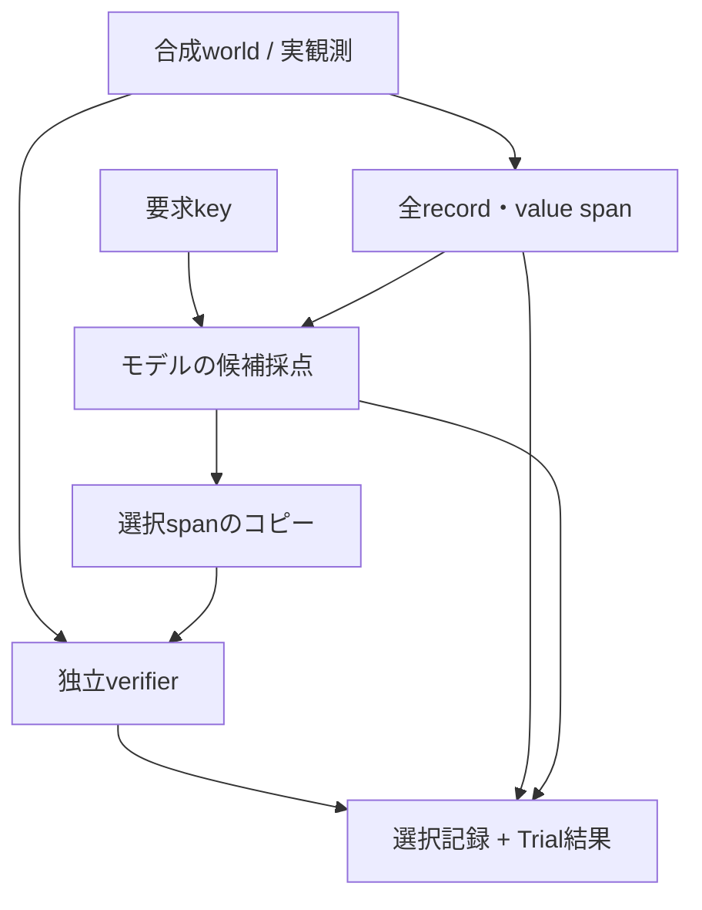

# 次の能力案: 外部情報を根拠に選ぶ

2026-10-14 JST。追跡: [READ #115](https://github.com/ryonakayama234/Aster/issues/115)。
**設計案 / 未実装 / 未凍結 / NOT_RUN**。現在の実験Gate [LANG #113](https://github.com/ryonakayama234/Aster/issues/113) の結果を踏まえて次の仕様を固める。

## なぜこの方向か

Asterの目的は外部の計算・記録・検索・実行を使い、返った情報で処理を進めること。
添付の計画書にあるTokenizer -> TinyLM -> Agent Loop -> Trace/Evaluator -> Memory/Searchの発展を、実装済みのAgent KernelとLANG診断へ結びつける。

偏りを「何の偏りか」で分ける。

| 不足・偏り | この設計が補える可能性 | 残る問題 |
| --- | --- | --- |
| 学習時に知らない固有名・数値・事実 | 実行時の外部記録から参照・コピー | 読み違い、根拠の取り違え |
| 大量の事実を重みに保存できない | 外部storeに保持して必要分だけ渡す | 短いcontextに選んで渡す必要 |
| 関係・指示・構文の学習が不足 | 小さなstructured課題で不足を測定できる | 参照機構だけでは読解を獲得しない |
| 外部資料自体が偏っている | 出典group別評価で失敗範囲を見せる | 資料の偏りは残る |

初期backboneが十分賢いという仮定は置かない。一方、意味を扱う最低限の学習まで不要になるとは主張しない。
初版の固定形式は境界を明確にするための足場であり、自由な日本語理解の完成形ではない。
型や候補器に正解を埋め込み、モデルの理解と呼ぶことを避ける。

## 現在の根拠と判断

- [LANG v0.3結果](LangContextUse-v03-results.md): 独立dev文書1件、追加学習0、TinyLMのbigramに対する差は0.0125869255 nats/token。相対perplexity低下1.250804%は正答率改善ではない。学習前後ともprefix変更へ6/6で反応。元文脈が役立つかは未判定。
- [LANG v0.4設計](LangContextBenefit-v04-plan.md): 保存済み6箇所の符号付き利益から始め、約8未使用prose文書/少なくとも4出典groupを採用する案。量は実施可能性の目安であり、検出力保証ではない。
- [OBS v0c結果コメント](https://github.com/ryonakayama234/Aster/issues/106#issuecomment-6123065099): 計算の後に早期stopした。成功calculator出力とput候補は存在していた。行動失敗であり、容量・Corpus・観測無視のいずれが原因かは未確定。
- [OBS v0d #108](https://github.com/ryonakayama234/Aster/issues/108): この失敗stepのoffline感度診断案。新しいREADの成功や一般化とは別。

Corpusの偏りや容量の小ささは競合仮説であって、失敗原因と確定していない。

## 作業順・達成目標

| 段階 | 作業 | 達成したと判定するもの |
| --- | --- | --- |
| 直近 #113-A | 保存済みprivate reportの同一性確認と全6箇所の利益/害/同等を集計 | 反応の向きが判明; 新しいforwardなし |
| #113-B | 未使用proseの出典・重複・派生確認、manifestと評価規則の凍結 | 独立groupで再現/混在/未観測を記録できる設計 |
| READ設計 | 要求・観測・全候補・正解sidecar・serializer・モデル識別を固定 | コード化可能な仕様; 完成モデルを前提にしない |
| READ G0/G1 | reference/negative control、候補完全性、UTF-8/長さ、ラベル非漏洩 | 測定器の正しさのみ |
| READ G2 | 1段階選択の小さなCPU Trial、全pair保存 | 観測に従った正しい変更か、失敗機構を特定 |

#113は能力PASSの前提試験ではなく、現在地を絞る診断。陽性を待って成功するまで反復するGateにしない。
混在/未観測でも結果を保存し、その失敗範囲を次のREAD設計へ反映する。新たな学習は別の予算/仕様で決める。
本セッションでは私的reportを取得していないので#113-Aは未実施。ユーザーのWSLだけにあるファイルの値を推測しない。

## READ v0で問う一つの能力

同じ要求 `wanted_key=answer` を与える。

| world | 全観測record | 正しい根拠と値 |
| --- | --- | --- |
| A | answer=42 / other=17 | answer側のspan -> 42 |
| B | answer=57 / other=17 | answer側のspan -> 57 |

H1: 根拠の関係を使い両worldに正答する。H0: 固定位置/既知値/formatに依存する、または選べない。
この例はproject-owned structured fixtureであり、ユーザーの日本語Corpusへの合成追加ではない。

初版候補器は全record/value spanを並べる。要求keyと一致するrecordだけに事前に絞らない。
モデルは参照候補を選択する。コピー器は選択spanのbytesを取り出すだけ。正解判定は別verifierが行う。
ルールでkey一致を選ぶreferenceは測定器の対照であり、Asterの学習成果ではない。



LANG checkpointとDecisionModelは異なるartifact。READのどちらを使用するか/新headを設けるかは設計Gateで選ぶ。
既存Decision入力はAction評価用であり、READへそのまま接続済みとは扱わない。現在のserializer/candidate builderを暗黙変更しない。

## データ契約案

| オブジェクト | 最小の内容 | モデル可視性 |
| --- | --- | --- |
| World | task_id, source_group, split, paired_world_id, observation records | 要求/実観測のみ; group/splitは採点管理側 |
| Candidate | candidate_id, record_ref, UTF-8 byte span, value, token count | 全候補を同じ規則で提示 |
| Selection | all scores, selected_ref, model/tokenizer/serializer IDs | モデル出力; 成功ラベルは含めない |
| Verifier sidecar | worldの正解record/valueと根拠関係 | モデルから不可視 |
| Run | protocol/manifest/source SHA, artifact lineage, resource use, verdict | 実験記録側 |

record_refは出所、spanは元bytesのどこからコピーしたかを示す。値と根拠が同時に合っていることを評価する。
UTF-8境界と実Tokenizer長を測る。context overflowは推論前にBLOCKEDとし、正解に合わせて切り詰めない。

## 測り方・失敗から次の問いへ

Primary候補は「両worldで根拠と値が正しいpair数 / 適格pair数」。答えが変わっただけでは成功にならない。
同一要求・候補数・順序を固定し、各worldの実観測から候補を作り直す。値だけを変えるpairでもtoken長不一致があれば報告し、意味だけの効果と扱わない。

補助対照: 妨害値変更、record順変更、未使用key/value系列。名前やseed違いを独立task familyに水増ししない。
同一generator/templateからの派生は同一splitに置く。上限6程度のdevelopment fixture groupで始める案だが、family定義/件数/予算/判定線は測定前に固定する。
初版は一意の根拠がある課題に限定する。根拠欠落/競合への棄権は後の別能力Gate。

| 観測される失敗 | 次に検証する一つの候補 |
| --- | --- |
| 順番を替えると崩れる | 候補位置shortcut |
| 未使用値で崩れる | 値の暗記か、コピー/Tokenizer境界の問題 |
| 参照選択が一貫してできない | 小さな関係学習でscratchと事前学習初期化をmatched条件で比較する設計 |
| 正しく選べるがAgentで誤用する | 選択済み値をtool引数へ結びつける別Gate |

scratch比較は将来の初期化介入案で、今の固定モデル評価と同時に学習を行うものではない。
単純なルールで解ける課題なら、実用のルールと学習研究を区別し、ニューラルモデルの優位を捏造しない。

## 継続記録の契約

各機能PRに、システム図、データ契約、仮説/比較/達成目標、実装と実測の状態、結果と次の一問を同時に置く。
旧Run/Artifactは不変、新しいcycleをappend。仕様変更後は旧claimを継続しない。
案の状態も記録する。

```json
{
  "cycle_id": "read-evidence-selection-design-v0",
  "status": "proposal_not_run",
  "experiment_mode": "trial",
  "evidence_scope": "design",
  "protocol_frozen": false,
  "measurement_run_id": null,
  "source_git_sha": null,
  "parent_artifact_id": null,
  "result": null
}
```

これは未実行のテンプレート。将来のRunではsource/artifact/manifestを実物で埋め、nullを推測で補わない。
CIのコード確認とprivate WSL能力計測を別に記録する。公開Gitはコード・合成fixture・安全な集計だけ。

担当: エージェント側で仕様・実装・Git/Issue/PR/CI・記録更新を進める。ユーザー側には必要時にproseの選定とWSL private実行を一度に一つ依頼する。
現在はprose新素材の必要性を #113 の設計に沿って整理し、私的モデルへのアクセスを装わない。

## 文献と転用範囲

- [Khandelwal et al., ACL2018](https://aclanthology.org/P18-1027/): LSTM文脈の並べ替え/置換/削除による分析。#113の手法上の参考。
- [Merity et al., Pointer Sentinel Mixture Models](https://arxiv.org/abs/1609.07843): 語彙からの生成と直近文脈からのコピーを組み合わせる。参照/コピーの先行例; このREAD案と同一モデルではない。
- [Lewis et al., RAG](https://arxiv.org/abs/2005.11401): 事前学習readerとretriever、外部Wikipedia indexを使う。外部知識分離の先行例であり、未成熟TinyLMへ検索を付ければ読めるという証拠ではない。
- [Eldan & Li, TinyStories](https://arxiv.org/abs/2305.07759): 限定された英語素材で小さな/単純なモデルの能力を示す。学習課題を限定する参考で、日本語Asterの17.4万parameterモデルへの保証ではない。

Wolframは既存NLL差と指数換算を検算した。計算確認とprivateモデル再測定は別。
