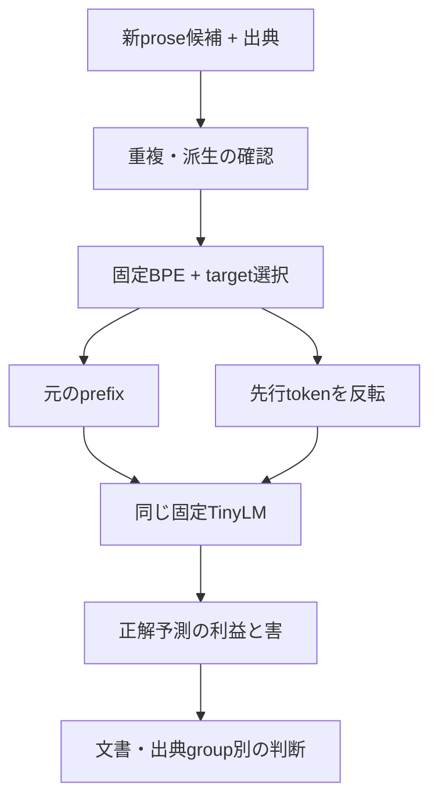

# LANG 次の設計案: 文脈が役立つか

2026-10-14 JST。Issue #113。**未実装・未凍結・未計測の案**。旧Trialの仕様と結果は変更しない。

## 狙う一つの能力

元の先行文脈を使うことで、次tokenの予測が改善するか。その傾向が独立した日本語proseの出典groupにまたがって再現するか。

H1: 先行tokenを反転した対照より、元の文脈で正解targetの平均NLLが低くなる。H0: 改善方向が不安定、元文書だけに限られる、または改善を観測しない。反転は分布外入力なので、陽性でも意味理解・因果機構の確証にはしない。

## まず既存の保存値を使う

WSLでprivate report bytesを読み、外側aggregateのprivate_report_sha256との一致を確認する。埋込みaggregateは、**外側aggregateからprivate_report_sha256だけを除いた内容**と照合する。既存writerはprivate report保存後にそのhashを外側へ追加するため、埋込み側に自己hashを要求しない。checkpoint step・選択件数の一致も確認する。集計対象は既存step0/200の既存全6箇所。例の差し替え・新しい採点・結果上書きは行わない。

`利益 = NLL(反転) - NLL(元) = logP(正解 | 元) - logP(正解 | 反転)`。

正なら元の文脈が有利。この補助集計の規則は、改善 `利益 > 1e-5`、悪化 `利益 < -1e-5`、同等 `abs(利益) <= 1e-5` の排他的な3区分とする。全値が有限で、3区分の和が選択件数と一致することを確認する。各stepで件数、3区分の件数、平均・中央値を出す。位置、token、本文、hash、個別case値はprivateに保つ。比較の符号を旧reportの `delta_logp_changed_minus_original` と取り違えない。step0との差は補助的に見るが、単独で学習の因果効果や理解を証明しない。

## 新しい素材の採用案

- 目安は未使用prose約8文書、少なくとも4つの出典group/session。実施可能性の目安であり、検出力計算や統計的独立性の保証ではない。
- ユーザーが目標とする語り口・題材から候補を選ぶ。自作・他者文章・AI対話の出典を区別し、今回はproseに絞る。dialogueは別評価にする。
- Train/BPE学習素材・既存dev/testとの重複や派生を検査する。sealed test本文をこの調査で開かない。既存のtestやpending-excluded素材を新しい独立資料と扱わない。
- 素材と出典台帳はローカルに保ち、public Gitには本文・私的ID/URL/hashを記載しない。新しい素材を自動でtrainへ入れない。

## 比較条件の案

計測前にlocal manifestと評価器のレビュー済みsourceを凍結する。checkpoint0/200、BPE、語彙、Corpus-v0、train-only bigram smoothing16は維持する。

1文書につき、16token以上のprefixを持つ適格targetから、scoreやtarget種類を見ずに最大16箇所を等間隔に選ぶ案。prefix最大128token。BOS、直前token、target、token集合、prefix長、絶対位置、attention形状を保って、それ以前のtokenを反転する。適格箇所が不足する場合の扱いも事前固定し、悪い結果を見て文書や位置を交換しない。

短いprefixへ切り詰める比較は初版の主比較にしない。現行TinyLMは入力長に応じて位置embeddingを0から付けるため、単純な切詰めでは文脈と絶対位置が同時に変わる。将来の距離別分析は別設計が必要。

主な記述量はstep200の文書ごとの平均利益。文書内を平均してから出典group内を平均し、最後にgroupを等重みでまとめる。全groupと全文書の結果を省略せず出す。step0とstep200-minus-step0の差は補助量。通常prefixのmatched unigram/bigram/TinyLM NLL・BPBも併記し、比較は同じ選択target上で行う。

数値許容差1e-5はゼロ付近の区別に用いるだけで、有意水準や実用的な合格線ではない。token件数を独立実験数に数えない。少数groupから広い一般化を宣言せず、再現／混在／未観測という記述的判断をする。最終的な必要量・選択条件・実用的判断基準は凍結前に検討する。

## データ構造と流れ

| 状態 | 内容 | 保存・公開 |
| --- | --- | --- |
| 既存private report | step別original/changed logP、位置情報 | WSLで維持 |
| 既存値の補助集計 | step別の符号件数・平均・中央値 | 数値だけ共有可能 |
| 新素材manifest案 | 出典group、派生関係、入力・BPE・checkpoint識別、選択規則 | privateで凍結する予定 |
| 新Trial結果案 | 文書・group別の利益、頻度基準との比較、除外・不足と限界 | private詳細と公開集計を分ける予定 |

図は予定する評価器の流れであり、実装済みの新Pipelineを意味しない。Training→Inferenceの固定modelを評価する範囲に留め、Message/Tool protocolやAgent Loopへ新しい能力を追加しない。

## 達成目標と判断

まず保存済み6箇所の反応方向を把握する。その後、素材と条件をレビュー可能な形で固定してから評価器を実装・検証する。

複数groupで元文脈の利益が再現した場合、次に別のデータ介入を一つだけ比べる研究へ進める。混在・未観測なら失敗が現れる題材・文脈長・頻度域を調べ、容量やCorpusを同時に変えない。どの結果でも、自動promotionや既存評価文書を用いた追加学習は行わない。

方法上の参考: [Khandelwal et al., ACL 2018](https://aclanthology.org/P18-1027/) はLSTMの先行文脈を並べ替え・置換・削除して予測の変化を分析した。手法を参考にするが、同論文の英語LSTMでの結果を日本語Asterの性能根拠にはしない。
