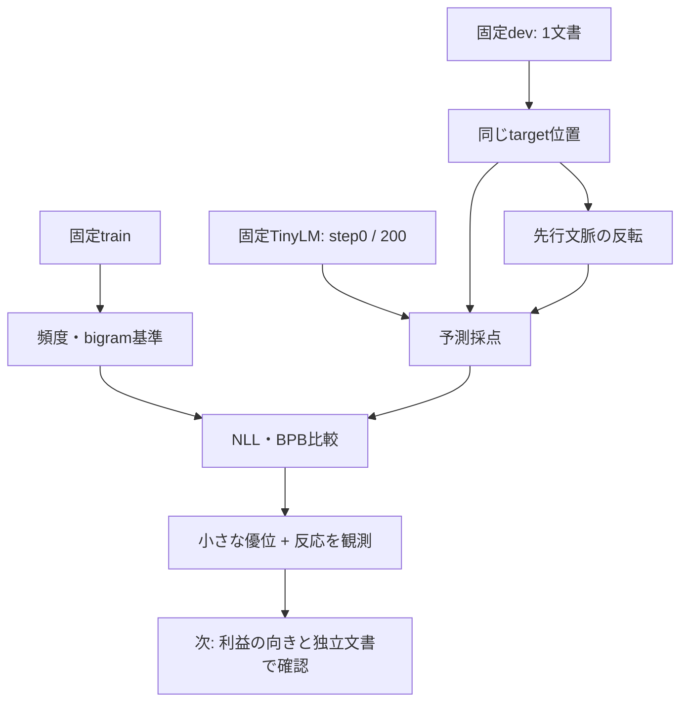

# LANG v0.3: 文脈利用の診断結果

2026-10-14 JST。仕様は [LangContextUse-v03.md](LangContextUse-v03.md)、追跡は Issue #110、次の設計案は Issue #113 と [LangContextBenefit-v04-plan.md](LangContextBenefit-v04-plan.md)。

## 証拠の取得と範囲

ユーザーがWSLに保存された aggregate.json の内容を共有した。計測版はレビュー済み `d1c75231e76820947f575fac22a51b46fc0add69`。`context_diagnostic_completed`、Trial、development diagnostic、独立dev文書1件、追加学習0、sealed test本文の閲覧なしと報告されている。

集計の構造・数値・比較対象数は共有内容から確認した。私的本文・checkpoint・private report実体にはアクセスしておらず、ローカル保存物の暗号学的再検証や測定の独立再実行はしていない。数式の検算と科学的な再現実験を区別する。私的hash、素材ID、本文、位置別の値はこの文書に転載しない。

直前のcheck-onlyは、既存Runがcompletedと記録され、固定名の4出力が存在することを返した。旧BLOCKEDが既存結果による再実行拒否だった可能性はあるが、旧停止理由は確定していない。結果を削除・再実行する必要はない。

## 観測値

すべて同じ8,016 target tokens。うちtext 8,015 tokens、16,063 bytes、EOS 1 token。NLLとtext BPBは小さいほど良い。

| 比較対象 | 見ている情報 | NLL nats/token | text BPB |
| --- | --- | ---: | ---: |
| Unigram | train全体のtoken頻度 | 5.730518478 | 4.124928166 |
| Bigram | trainでの直前1tokenとの共起 | 4.754749612 | 3.422181486 |
| TinyLM step0 | 学習前の固定model、同じprefix | 6.253697423 | 4.501810808 |
| TinyLM step200 | 学習後の固定model、同じprefix | 4.742162686 | 3.412957673 |

- Bigram - step200 NLL = **0.0125869255 nats/token**。この1文書ではTinyLMが小さく優位。
- Bigramとの相対perplexity差は `1-exp(-0.0125869255)` = **1.250804%の低下**。正答率の改善率ではない。
- NLL値に対する相対差は0.264723%。尺度が異なるので、perplexity差と取り違えない。
- Text BPB差は **0.0092238127 bits/byte**。
- Unigram→TinyLMのNLL差に対し、Unigram→bigramの差の比率は **98.726478%**。これは集計差の算術比で、TinyLM内部の機構や因果的な寄与率を測った値ではない。頻度・直前tokenの基準が今回の改善幅にかなり近い、という比較上の観測に留める。
- Train targets 45,481、parent training token presentations 202,172。trainのユニーク量と繰返し提示量は別。
- Devの直前token未出現は159/8,016 targets、train出現回数16以下は181/8,016。未出現群は少数頻度群の一部であり、足し合わせない。

Wolframで上記の差・比率・指数換算を検算した。これは共有値の計算確認であり、private modelの再測定ではない。

## 文脈変更: 反応と有用性の区別

| 固定checkpoint | 反応した位置 | 正解tokenの順位が変わった位置 |
| --- | ---: | ---: |
| step0 | 6/6 | 6/6 |
| step200 | 6/6 | 3/6 |

直前token、target、prefix長、位置などを保った先行token順序の変更に、学習後modelは反応している。しかし学習前も6/6で反応している。**反応件数だけでは学習により獲得した有益な文脈利用を示せない。** 学習後に順位変更件数が減ったことも、品質向上・劣化のどちらとも判定できない。

公開aggregateには方向と大きさの要約がないため、「本来の文脈で正解を予測しやすくなったか」は未判定。private reportに既存のoriginal/changed target log-probabilityが保存されているため、追加forwardなしに符号付きの差を集計できる。6箇所は1文書内の診断位置であり、独立文書6件ではない。反転入力は不自然な分布外入力になり得る。

## EOSの観測

EOS NLLはunigram 8.790378、bigram 11.424961、step200 13.226311。step200のこの1つのEOS位置での割当確率は約0.00000180255。終了tokenを高く予測できていない観測と整合するが、EOS評価は1件であり、一般的な終了能力の判定には不足する。今回は別能力として学習目標を追加しない。

## 診断判定と次の問い

事前仕様の記述的判定 `observed_on_one_development_document` に整合する。`capability_pass=false` は仕様上固定されており、今回の配線失敗を意味しない。1文書における小さな優位と反応は観測されたが、意味理解・日本語対話・広い文脈能力・統計的有意差は示していない。数値許容差1e-5は有意水準ではない。

次の一つの問いは **「元の先行文脈が正解予測に役立ち、それが独立した文章でも再現するか」**。

1. 既存6箇所の符号付き差をローカルで集計し、step0/200それぞれの改善・悪化・同等件数と平均・中央値を得る。私的本文や位置情報は共有しない。これは事後的な補助分析と明示する。
2. その後、新しい日本語prose候補をユーザーと選び、出典・session・派生・学習素材との重複を確認する。Drive inboxは本日metadata一覧で空だった。既存poolのtestや除外資料を独立評価へ改名しない。
3. 計測前に対象・選択規則・比較条件を固定し、複数文書・出典groupごとの利益と害を報告する。モデル・Corpus・Tokenizerはこの比較中に変更しない。

これにより、後の `評価結果 → 失敗の分類 → 一つのデータ介入 → 別の評価 → 採否` の循環で、何を矯正するかを定める。現時点で容量増大、継続学習、Corpus混合変更、RL、Agent変更へ進む根拠はまだない。

## データと判断の流れ

文脈変更の採点結果を保存済みprivate reportから集計する次段階と、新しい素材を評価する段階は分ける。
