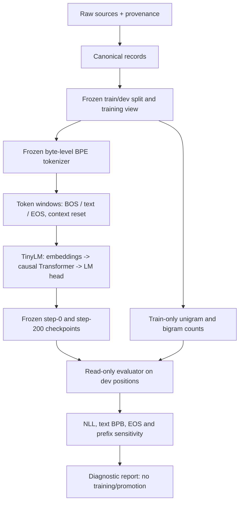
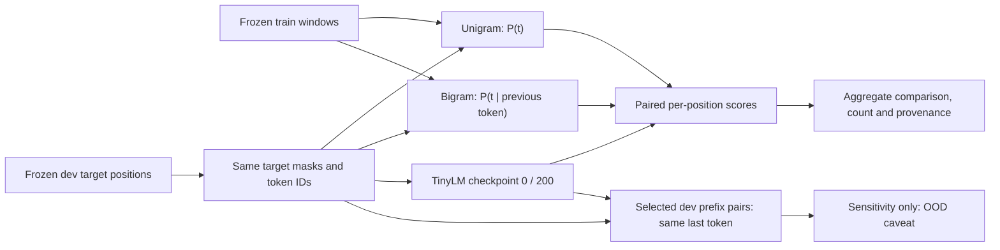

# LANG v0.3 — TinyLM multi-token context use: read-only diagnostic protocol

Status: **implementation prepared; private WSL measurement not executed**. Parent [Issue #110](https://github.com/ryonakayama234/Aster/issues/110), under [LANG #21](https://github.com/ryonakayama234/Aster/issues/21). The user authorized implementation on 2026-10-13 JST. This revision extends the original documentation-only PR #111 into the diagnostic implementation. No model, Corpus, tokenizer, train configuration or prior Run is modified.

## One capability, one question

**Capability under investigation:** Does Aster's existing causal TinyLM use more than the immediately previous token to improve held-out next-token probability?

The existing 174,080-parameter TinyLM uses vocabulary 514 (BOS/EOS included), maximum context 128, width 64, two transformer blocks, four attention heads. The frozen pilot is 200 CPU optimizer updates. Observed Gate 3 dev NLL moved from 6.2537 (step 0) to 4.7422 (step 200), versus a train-only unigram reference NLL 5.7305. This alone does **not** establish use of multi-token context, semantics, or dialogue. One dev Japanese prose document limits independence and generalization claims.

### Hypotheses

- **H1:** On exactly matched dev targets, frozen step-200 TinyLM has lower NLL than a train-only smoothed bigram baseline; changing earlier context with the same last token also changes model predictions on selected diagnostic positions.
- **H0:** Most apparent improvement is compatible with marginal frequency and/or one-step token transition patterns; incremental useful multi-token context is not established.
- **Underdetermined alternatives:** corpus skew, insufficient optimization, tiny width/capacity, BPE fragmentation, window reset/document handling, and out-of-distribution counterfactual prefixes. A negative trial does not uniquely identify the cause.

## System architecture (existing, unchanged)



## Data and evaluation flow: this trial only



Important: the bigram is a statistical **control**, not an alternative neural model. A context-length-128 architecture does not prove that the learned network uses 128 tokens.

## G0 — Immutable identity gate

1. Confirm reviewed exact source commit, source-file/code hashes as used by LANG Gate 3, tokenizer/view/artifact IDs, run experiment metadata, frozen step-0 and step-200 checkpoint byte hashes and architecture (174,080 parameters, vocab 514, context 128).
2. Verify train/dev split/source grouping and normalizer/tokenizer identity. Do **not** read sealed test text. Do **not** upload private samples or checkpoint bytes to public GitHub.
3. Read immutable source/checkpoint bytes from verified snapshots for their later use; reject mismatch, missing private local files, incompatible PyTorch/runtime or mask/target semantics.
4. Do not overwrite earlier Runs. The reviewed implementation creates **one new exclusive diagnostic Run** after preflight, and refuses any existing output directory. Private measurement follows code review; synthetic validation is not a model result.

## G1 — Tokenizer interface preflight (not tokenizer optimization)

Use existing synthetic fixtures and permitted data to verify encode/decode round-trip, BOS/EOS distinction, valid target positions, window boundary handling and bytes/token accounting. Do not retrain or change BPE IDs or special-token IDs.

## G2 — Matched train-only frequency controls

For each train window, collect pairs `(u, t)` at precisely those positions that the model's training loss regards as valid. `u` is the immediately preceding model-visible token; `t` is the target. Count BOS as possible predecessor and EOS as a possible target; never predict padding as a valid target. Match the existing Gate 3 unigram conventions exactly (including smoothing support and BOS handling) before scoring dev.

**Predeclared** bigram estimator (fixed before private scoring):

```text
q0(t)     = [count_train(t) + 1] / [N_train + |V|]
q1(t | u) = [count_train(u,t) + 16*q0(t)] / [count_train(u) + 16]
```

Here `|V|=514`; all counts come **only from train**. `count_train(u)` means the outgoing row count, `sum_t count_train(u,t)`, collected on valid target pairs within each training window. Never add document/window boundary pairs by joining windows. The interpolation pseudocount `16` is a fixed design constant, not an empirically optimized setting. If reviewers change it, freeze a new protocol version **before** private scoring. No tuning based on dev and no selective reporting of alternative smoothing parameters. Like Gate 3 and the neural softmax, the smoothed support includes BOS with zero observed target counts; BOS is never an evaluated target.

On the **exact same** dev target indices, report:

- `NLL_unigram`, `NLL_bigram`, `NLL_TinyLM_step0`, `NLL_TinyLM_step200` in natural-log units per valid target, with valid target counts;
- primary descriptive contrast `delta_context_NLL = NLL_bigram - NLL_TinyLM_step200` (positive = TinyLM better on this dev set);
- text BPB calculated with **non-special target loss only**, divided by `log(2) * matched target byte count`; report EOS count/NLL separately;
- conditional counts, rare/unseen predecessor frequency, and total train token exposure for interpretability;
- no inferential confidence interval over independent documents from a single dev document; no cross-tokenizer per-token perplexity comparison.

Formal definition:

```text
NLL(model) = - sum_{i in fixed valid targets} log P_model(target_i | allowed prefix_i)
             / number_of_fixed_valid_targets
```

A positive delta on one document is diagnostic, not a generalization verdict.

## G3 — Frozen-prefix sensitivity (separate supporting diagnostic)

Preselect a small set of dev target positions before scoring. For each, compare the original prefix and a counterfactual of the **same token length**, with the same immediate previous token, target, position, tokenizer and attention mask, but with earlier prefix tokens changed. Record the target log-probability delta and whether target rank changes. The comparison detects model dependence on earlier tokens; it **cannot** prove beneficial use of real-world context because changed prefixes may be OOD. Preserve original-prefix predictions, audit no target leakage, and keep private text local. Do not treat many token positions within one document as independent tasks.

The implementation freezes this exact selection/intervention before scoring:

- Traverse sorted verified dev windows, then target positions ascending. Eligible prefixes contain at least four tokens and the intervention changes the input. Selection does not inspect model scores or target token identity.
- Reverse all earlier prefix tokens, preserving leading BOS when present and the immediately previous token. Token count, token multiset, last-token identity, target, final position and attention geometry are unchanged. Reordered byte BPE tokens may form invalid UTF-8 or unnatural text: this is an offline sensitivity probe, never a generated-text quality result.
- Select at most six evenly spaced indices from the ordered eligible list using `i*(N-1)//(K-1)`; if only one, use index zero. Use fewer if fewer are eligible. No post-result substitutions. Write the selected positions to `inputs.json` before TinyLM scoring. No cases means the mechanism is not distinguished.
- Log target log-probability and competition rank (`1 + count(logit > target_logit)`) under both inputs. Threshold for detected target-logp change is absolute `1e-5`; primary NLL contrast uses the same predeclared numeric tolerance. These are numerical decision tolerances, not statistical significance levels. Original prefix scores must replay the same per-position NLL within absolute/relative `1e-5`.
- Report step 0 and step 200, with step 200 the primary descriptive endpoint. Never choose a checkpoint after inspecting results.

## G4 — Observations, decision and stop rules

| Observation on matched dev | Allowed conclusion | Separate next research question |
| --- | --- | --- |
| TinyLM NLL lower than bigram + earlier-prefix sensitivity | Evidence compatible with additional context being used on this dev slice | Prospective *independent multi-document* context capability evaluation |
| Bigram NLL as good or better; weak/no prefix response | No demonstrated useful multi-token context | Is the bottleneck training exposure/corpus quality or capacity? Isolate later |
| TinyLM better but prefix test uninformative; or prefix response without NLL improvement | Mechanism not distinguished / sensitivity not utility | Repair diagnostic controls before expanding experiment |

Stop at a short `observed / not observed / mechanism not distinguished` report with exact counts, frozen identities, uncertainty and one next hypothesis. No new model training, RL, SFT, synthetic data generation, corpus mixing, decision head, tool/agent changes, GPU/cloud run or sealed-test inspection.

## Research context: why feedback-directed Corpus comes *after* this

Aster's long-term direction can be `failed cases -> categorized diagnostic -> controlled candidate data selection -> matched-budget re-train -> independent evaluation -> accept/reject`. That is an **architectural proposal**, not a component built in LANG v0.3. Separate future iterations might test:

- Corpus *mix* selection motivated by DoReMi (Xie et al., NeurIPS 2023, https://arxiv.org/abs/2305.10429).
- Selective train-token weighting motivated by Rho-1 (Lin et al., NeurIPS 2024, https://arxiv.org/abs/2404.07965); Aster cannot assume access to an equivalently strong reference model.
- Controlled data ablations motivated by DCLM (Li et al., 2024, https://arxiv.org/abs/2406.11794).
- Small-model / restricted-corpus inspiration from TinyStories (Eldan & Li, 2023, https://arxiv.org/abs/2305.07759).
- Diminishing returns of repeat-only learning from Scaling Data-Constrained Language Models (Muennighoff et al., 2023, https://arxiv.org/abs/2305.16264).

None of these publications proves transfer of published gains to Aster's 174k-parameter regime. Later interventions must keep a fixed input identity, matched token/compute budget, independent evaluation splits, and no automatic checkpoint promotion.

## Deliverable and GitHub workflow

- **This PR, following user implementation authorization:** isolated train-only bigram scorer, matched TinyLM scorer, prefix sensitivity, synthetic regression tests and exclusive private Run writer. Existing training/evaluation modules remain unchanged.
- **Runtime:** existing user-owned WSL2 private assets, only at exact reviewed source revision and without uploading private text/weights; GitHub CI is a code-correctness check, **not a language-capability result**.
- Mark Issue #110 completed only after the protocol and actual diagnostic evidence are separately documented. Avoid unrelated OBS/DIAG/Agent branches and never silently edit `main`.

## 実装・手元での実行

今回の能力は「一tokenを超える文脈利用」。仮説が外れても、比較と原因候補の整理が完了すれば診断作業は完了する。学習配分の変更、継続学習、Corpus追加は次の別Trial。

| ファイル | 役割 |
| --- | --- |
| `src/aster/training/lang_context.py` | train-only bigram、同じ位置の採点、文脈変更と診断判定 |
| `scripts/run_lang_v03_context.py` | ソース・元Run・入力の照合、新しいprivate診断Runへの保存 |
| `tests/training/test_lang_v03_context.py` | 人工データによる数値、保存、破損拒否、既存Run保護の検証 |

既存の `scripts/run_lang_v01_utf8.py` のsource-only import loaderを、Git照合済みbytesから再利用する。新しい実行器・Gate4・全Aster依存も同じGit revisionに束縛し、古い `.pyc` を実行しない。Pythonの `-I` 隔離モードを必須とし、stdlibを読む前に非隔離起動を拒否する。helperが追加するsrc/scripts探索ルートの未追跡・ignored Python/nativeコードやsymlinkも拒否し、ローカルtorch.py等による依存の差し替えを防ぐ。ユーザーのファイルは削除しない。Gate 3の固定view/BPE/ソースhash、元reportのSHA、checkpointのSHAと実体、PyTorchのbuild一致も検証する。train/dev本文は再度hash確認した同じbytesからtoken化し、sealed test本文は開かない。

手元の既存Python環境から、**レビュー済みの正確な40桁commitへ切り替えたcheckout**で一度だけ実行する。`<reviewed SHA>` はPRの実際のレビュー済みheadまたはmerge SHAを使い、動的に現在のHEADを代入して自己承認しない。

```sh
.venv/bin/python -I scripts/run_lang_v03_context.py --root . --expected-commit <reviewed SHA>
```

未コミット作業を保護するため、既存の手元作業をcommit/reset/stashさせない。別checkoutを使う場合、検証済みprivate view・Tokenizer・元Runをそのcheckoutへローカルコピーする必要がある。private素材をGitにaddしない。

出力は新しい `runs/lang-v03-context-diagnostic/`（0700）。`inputs.json`、`private-report.json`、`aggregate.json`、`run.json` は0600。元Run `f884ea724e854ab09ed6a3944f03f8f2` は書き換えない。既存出力があれば停止し、失敗後も同じディレクトリを黙って削除して再実行しない。stdoutは集計値だけ。private reportには位置別NLL・選択位置・入力hashがあるのでローカルに保持する。

集計結果の `delta_context_nll_nats` は **bigram NLL - TinyLM step200 NLL**。正ならこのdev文書でTinyLMが優位。`detected_prefix_changes` は6件以下の診断位置での反応数。`capability_pass` は常にfalseで、`observed_on_one_development_document` 等の記述的判定だけを返す。コードのCI成功と私的モデルの能力測定を分ける。

## 素材の次の準備（2026-10-13 JST）

DriveのAster/data/inboxは一覧確認時に空。既存poolのprose 10件・dialogue 12件は、件数・番号体系・サイズが既存v0の出典台帳と整合するが、本文一致を検証したわけではない。既存のtest素材は内容を読まず、pending_excludedや未解決sessionを独立devに改名しない。新しい独立評価素材の採用はまだなし。次回は出典/sessionの独立性を確認できる小さな候補集合から、ユーザーと目標の語り口・用途を相談して選ぶ。本文・Drive ID/URL・私的hashはこのpublic文書に記録しない。

## 検証記録（2026-10-13 JST）

- Python 3.12 / PyTorch 2.14.1+cpuで全386 tests PASS、Pyright 0 errors / 0 warnings。うち新規18 casesは人工素材のみ。
- 実際のTinyLM checkpoint形式を使った人工Runを一周し、元Runの全ファイルdigest不変、0600/0700保存、再実行拒否を確認。checkpoint破損・PyTorch不一致・評価target数不一致では集計成功を出さない。
- Bigramの正規化・未出現predecessorのunigramへのbackoffをWolframで検算。これは数式・コードの確認であり、私的Asterへの効果の証拠ではない。
- 本物のprivate view・保存済みRunにはアクセスしていない。実測NLL、文脈反応、モデル改善は未測定。新しい学習、Tokenizer fitting、Drive書込み、sealed test本文の閲覧はなし。
- 独立CodexレビューのP2（未追跡コードによるtorch import shadowing）を修正。隔離起動、未追跡・ignored module拒否、symlink package拒否、ローカルjson/__future__差し替え非実行を検証し、新規診断testsは27 cases PASS、Pyright 0 errors / 0 warnings。初期386件の記録は修正前の全体検証であり、修正後headのGitHub CI・再レビューを別に確認する。

## BLOCKEDの原因確認（2026-10-14 JST）

ユーザーのWSL実行は旧版の汎用 `BLOCKED` で停止した。旧表示は複数の停止理由をまとめていたため、具体的な原因・採点到達の有無はstdoutから判別できない。NumPy warningの後も実行が続いており、警告だけを停止原因と決めつけない。私的Runの内容は未確認。

新しい停止表示は `stage`（止まった段階）、`code`、日本語の `note` を持つ。PyTorch版不一致では確認済みの形式の版を表示し、ファイル不足では既知の記録ファイル名だけを表示する。例外本文・traceback・私的path・本文・token列はstdoutに出さない。新しい採点失敗では、同じ安全な停止情報を新規Runのrun.jsonに保存する。既存の失敗Runは修正・削除しない。

まず `--check-only` を使う。これはソース・入力・記録・train頻度count identity・target数・checkpoint identityだけの確認で、TinyLM、unigram、bigramの予測採点、prefix感度測定、新しい診断Runの作成を行わない。既存出力がある場合は先に固定名のファイル存在とrun.jsonの状態だけを確認して返し、private-report本文を読まず、測定の再実行をしない。check-only通過はモデル能力の判定や採点再実行の許可ではない。

```sh
.venv/bin/python -I scripts/run_lang_v03_context.py --root . --expected-commit <reviewed SHA> --check-only
```

Git操作をまとめる `scripts/check_lang_v03_context.sh` も用意した。未コミット作業があれば停止し、レビュー済み版へ一時的に切り替え、成功・停止どちらでも元のbranch/detached commitへ戻る。実際のレビュー済みSHAを固定して、fetch後に `git show <reviewed SHA>:scripts/check_lang_v03_context.sh | bash -s -- <reviewed SHA>` と呼ぶ。最新版main/現在HEADを自動的に信頼せず、runを削除するオプションも設けない。

独立レビューで指摘されたignoredファイルの上書きを防ぐため、切替・復元の両方に `--no-overwrite-ignore` を指定する。対象版のtrackedファイルと手元のignored素材が衝突した場合は、素材を維持して採点前に停止する。人工Git repositoryで衝突拒否・元branchとcommitの維持・素材bytes不変・Python非実行を確認した。

再レビューに従い、通常測定での基準モデル構築・unigram採点・bigram採点・保存値との照合も、新規Runの失敗記録対象に含めた。各段階で人工的に失敗させ、元Run不変・安全な停止理由の保存・同じRunの再実行拒否を確認する。check-onlyの無採点・Run未作成は維持する。

| 表示 | 次に確認すること |
| --- | --- |
| MISSING_LOCAL_FILE | 表示された記録ファイルの配置。学習し直さない |
| PYTORCH_VERSION_MISMATCH | 学習時と現在の版。環境を無条件にupgradeしない |
| EXISTING_DIAGNOSTIC | 既存Runの状態とファイル有無。削除・再実行しない |
| PREFIX_REPLAY_MISMATCH | 元入力の採点一致。小さな仮説検証の結果と混同しない |
| PREFLIGHT_PASSED | 前処理・記録の確認通過。元停止の原因が採点中だった可能性を別に調べる |

検証：原因表示・check-onlyを含む全体401 tests PASS、ignored素材保護修正までのPR CIは全404 tests PASS。最終追加した基準モデル失敗保存を含む診断40 cases PASS、Pyright 0 errors / 0 warnings、Bash syntax PASS。人工checkpointでcheck-only中のTinyLM・unigram・bigram・prefix採点を禁止し、新しいRunが作られず元Runのdigestが変わらないことを確認した。私的WSLの停止原因そのものは未確定で、入力変更・測定再実行の判断は原因確認後に行う。
