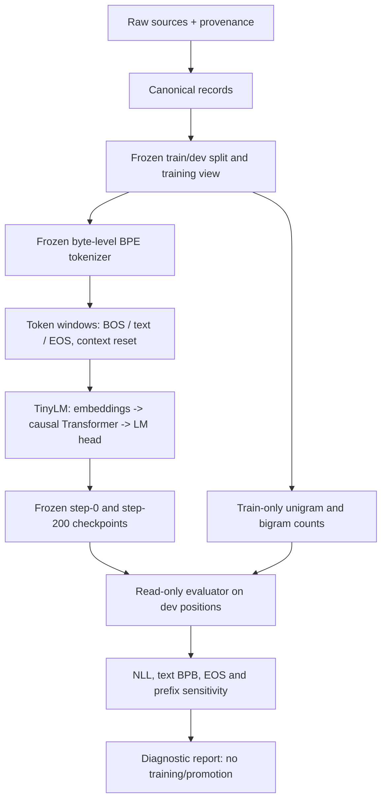
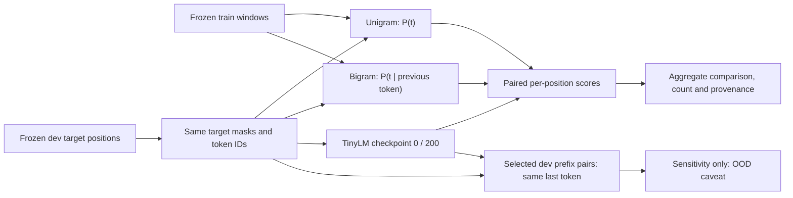

# LANG v0.3 — TinyLM multi-token context use: read-only diagnostic protocol

Status: **design proposal / not executed**. Parent [Issue #110](https://github.com/ryonakayama234/Aster/issues/110), under [LANG #21](https://github.com/ryonakayama234/Aster/issues/21). No model, Corpus, tokenizer, train configuration or prior Run is modified by this document.

## One capability, one question

**Capability under investigation:** Does Aster's existing causal TinyLM use more than the immediately previous token to improve held-out next-token probability?

The existing 174,080-parameter TinyLM uses vocabulary 514 (BOS/EOS included), maximum context 128, width 64, two transformer blocks, four attention heads. The frozen pilot is 200 CPU optimizer updates. Observed Gate 3 dev NLL moved from 6.2537 (step 0) to 4.7422 (step 200), versus a train-only unigram reference NLL 5.7305. This alone does **not** establish use of multi-token context, semantics, or dialogue. One dev Japanese prose document limits independence and generalization claims.

### Hypotheses

- **H1:** On exactly matched dev targets, frozen step-200 TinyLM has lower NLL than a train-only smoothed bigram baseline; changing earlier context with the same last token also changes model predictions on selected diagnostic positions.
- **H0:** Most apparent improvement is compatible with marginal frequency and/or one-step token transition patterns; incremental useful multi-token context is not established.
- **Underdetermined alternatives:** corpus skew, insufficient optimization, tiny width/capacity, BPE fragmentation, window reset/document handling, and out-of-distribution counterfactual prefixes. A negative trial does not uniquely identify the cause.

## System architecture (existing, unchanged)



## Data and evaluation flow: this trial only



Important: the bigram is a statistical **control**, not an alternative neural model. A context-length-128 architecture does not prove that the learned network uses 128 tokens.

## G0 — Immutable identity gate

1. Confirm reviewed exact source commit, source-file/code hashes as used by LANG Gate 3, tokenizer/view/artifact IDs, run experiment metadata, frozen step-0 and step-200 checkpoint byte hashes and architecture (174,080 parameters, vocab 514, context 128).
2. Verify train/dev split/source grouping and normalizer/tokenizer identity. Do **not** read sealed test text. Do **not** upload private samples or checkpoint bytes to public GitHub.
3. Read immutable source/checkpoint bytes from verified snapshots for their later use; reject mismatch, missing private local files, incompatible PyTorch/runtime or mask/target semantics.
4. Do not overwrite earlier Runs. A future implementation may create **one new append-only diagnostic Run** only after separate code review. Until then this PR is documentation only.

## G1 — Tokenizer interface preflight (not tokenizer optimization)

Use existing synthetic fixtures and permitted data to verify encode/decode round-trip, BOS/EOS distinction, valid target positions, window boundary handling and bytes/token accounting. Do not retrain or change BPE IDs or special-token IDs.

## G2 — Matched train-only frequency controls

For each train window, collect pairs `(u, t)` at precisely those positions that the model's training loss regards as valid. `u` is the immediately preceding model-visible token; `t` is the target. Count BOS as possible predecessor and EOS as a possible target; never predict padding as a valid target. Match the existing Gate 3 unigram conventions exactly (including smoothing support and BOS handling) before scoring dev.

Suggested **predeclared** bigram estimator for review:

```text
q0(t)     = [count_train(t) + 1] / [N_train + |V|]
q1(t | u) = [count_train(u,t) + 16*q0(t)] / [count_train(u) + 16]
```

Here `|V|=514`; all counts come **only from train**. The interpolation pseudocount `16` is a proposed fixed design constant, not an empirically optimized setting. If reviewers change it, freeze a new protocol version **before** dev inspection. No tuning based on dev and no selective reporting of alternative smoothing parameters.

On the **exact same** dev target indices, report:

- `NLL_unigram`, `NLL_bigram`, `NLL_TinyLM_step0`, `NLL_TinyLM_step200` in natural-log units per valid target, with valid target counts;
- primary descriptive contrast `delta_context_NLL = NLL_bigram - NLL_TinyLM_step200` (positive = TinyLM better on this dev set);
- text BPB calculated with **non-special target loss only**, divided by `log(2) * matched target byte count`; report EOS count/NLL separately;
- conditional counts, rare/unseen predecessor frequency, and total train token exposure for interpretability;
- no inferential confidence interval over independent documents from a single dev document; no cross-tokenizer per-token perplexity comparison.

Formal definition:

```text
NLL(model) = - sum_{i in fixed valid targets} log P_model(target_i | allowed prefix_i)
             / number_of_fixed_valid_targets
```

A positive delta on one document is diagnostic, not a generalization verdict.

## G3 — Frozen-prefix sensitivity (separate supporting diagnostic)

Preselect a small set of dev target positions before scoring. For each, compare the original prefix and a counterfactual of the **same token length**, with the same immediate previous token, target, position, tokenizer and attention mask, but with earlier prefix tokens changed. Record the target log-probability delta and whether target rank changes. The comparison detects model dependence on earlier tokens; it **cannot** prove beneficial use of real-world context because changed prefixes may be OOD. Preserve original-prefix predictions, audit no target leakage, and keep private text local. Do not treat many token positions within one document as independent tasks.

## G4 — Observations, decision and stop rules

| Observation on matched dev | Allowed conclusion | Separate next research question |
| --- | --- | --- |
| TinyLM NLL lower than bigram + earlier-prefix sensitivity | Evidence compatible with additional context being used on this dev slice | Prospective *independent multi-document* context capability evaluation |
| Bigram NLL as good or better; weak/no prefix response | No demonstrated useful multi-token context | Is the bottleneck training exposure/corpus quality or capacity? Isolate later |
| TinyLM better but prefix test uninformative; or prefix response without NLL improvement | Mechanism not distinguished / sensitivity not utility | Repair diagnostic controls before expanding experiment |

Stop at a short `observed / not observed / mechanism not distinguished` report with exact counts, frozen identities, uncertainty and one next hypothesis. No new model training, RL, SFT, synthetic data generation, corpus mixing, decision head, tool/agent changes, GPU/cloud run or sealed-test inspection.

## Research context: why feedback-directed Corpus comes *after* this

Aster's long-term direction can be `failed cases -> categorized diagnostic -> controlled candidate data selection -> matched-budget re-train -> independent evaluation -> accept/reject`. That is an **architectural proposal**, not a component built in LANG v0.3. Separate future iterations might test:

- Corpus *mix* selection motivated by DoReMi (Xie et al., NeurIPS 2023, https://arxiv.org/abs/2305.10429).
- Selective train-token weighting motivated by Rho-1 (Lin et al., NeurIPS 2024, https://arxiv.org/abs/2404.07965); Aster cannot assume access to an equivalently strong reference model.
- Controlled data ablations motivated by DCLM (Li et al., 2024, https://arxiv.org/abs/2406.11794).
- Small-model / restricted-corpus inspiration from TinyStories (Eldan & Li, 2023, https://arxiv.org/abs/2305.07759).
- Diminishing returns of repeat-only learning from Scaling Data-Constrained Language Models (Muennighoff et al., 2023, https://arxiv.org/abs/2305.16264).

None of these publications proves transfer of published gains to Aster's 174k-parameter regime. Later interventions must keep a fixed input identity, matched token/compute budget, independent evaluation splits, and no automatic checkpoint promotion.

## Deliverable and GitHub workflow

- **This PR:** reviewable short protocol and Mermaid diagrams only.
- **Later separate PR after protocol review:** isolated train-only bigram scorer + synthetic regression tests + append-only private Run writer, with preservation of the existing gate and no training.
- **Runtime:** existing user-owned WSL2 private assets, only at exact reviewed source revision and without uploading private text/weights; GitHub CI is a code-correctness check, **not a language-capability result**.
- Mark Issue #110 completed only after the protocol and actual diagnostic evidence are separately documented. Avoid unrelated OBS/DIAG/Agent branches and never silently edit `main`.
