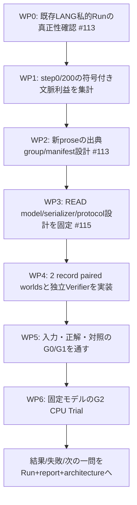
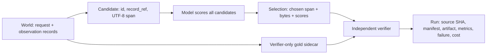

# READ v0 — 実行可能な作業指示書（提案・NOT_RUN）
2026-10-15 JST。追跡: [LANG #113](https://github.com/ryonakayama234/Aster/issues/113) → [READ #115](https://github.com/ryonakayama234/Aster/issues/115) / [Draft PR #116](https://github.com/ryonakayama234/Aster/pull/116)。

## 成果の定義
**一つの能力:** 与えられた短い実Observationの全候補から、要求されたkeyに一致する根拠value spanを**モデルが選び**、選択した値をプログラムがbyte単位でコピーして出典を残すこと。
成果は「モデル能力」「実験器の正常動作」「公開ドキュメント整備」を別々に判定する。Corpus容量/偏りは解消したと主張しない。READ v0は検索・日本語自由会話・長期計画・自己学習ではない。

## 依存関係の図

WP0〜WP2は**LANGの診断**、WP3〜WP6は**READの設計と測定**。ひとつのTrialへ統合しない。

## 作業パッケージと検収基準
| WP | エージェントに委任する具体作業 | 成果物 | 完了条件 / Stop |
| --- | --- | --- | --- |
| 0 | 既存WSL private `runs/lang-v03-context-diagnostic/` の `aggregate.json`・`private-report.json` の存在/sha256/embedded aggregate一致を**読取専用**で検査。原本、モデル、testを開かず、値を推測しない | ローカルread-only検査CLIとsafeな集計status | hash/identity/step/case不一致・private Run不在なら **BLOCKED**、勝手に再測定しない |
| 1 | 保存済みstep0/step200各6 caseの `benefit=original_target_logp-changed_target_logp` を集計。有限値・case数・三分類を検証 | benefit>1e-5 / <-1e-5 / 同等の件数、平均・中央値のみ公開可能 | 各stepで改善+悪化+同等=6、全finite、追加forward=0、training=0。事後診断と明記 |
| 2 | 旧test/devと混同しない**ユーザー選定**の未使用日本語proseを目安8文書・出典/session group目安4以上で監査。provenance、派生、train/BPEとの重複、対象位置選択規則を凍結前検査 | 非公開source manifest案と公表可能なgroup件数・採否 | 採用資料不足なら不足を記録して停止。旧資料を新holdoutへ付け替えない。新採点前にmanifest/規則固定 |
| 3 | 既存LANG checkpointとDecisionModelを別Artifactとして監査し、READ用の**同一world全候補採点**が実現可能か決定。model/Tokenizer/context/serializer/候補提示/スコア規則/CPU budgetを固定 | READ protocol / model eligibility表、architectureリンク | 互換性未解決なら**DESIGN_BLOCKED**。新headや重み移植を黙って実装せず別提案へ |
| 4 | 2 recordのstructured `World`、全value-spanの`Candidate`、正解を分離した`Verifier sidecar`、`Selection`・`Run` schemaを作り、generator・reference key matcher・固定位置対照を実装 | project-owned fixtureとunit tests、manifest案、データフロー図 | 全候補列挙、全byte span可逆、query-keyによる候補事前除外0、gold混入0 |
| 5 | **G0/G1**: manifest固定、split/派生、UTF-8境界、Token/context長、sidecar不可視、deterministic replay、referenceと位置対照を独立にチェック | preflight report（合格/欠落/ブロック全件） | 合法fixtureでreference **48/48ペア**、固定位置 **24/48ペア**、整合/再現/無漏洩すべて100%。一つでも破れたらG2を起動しない |
| 6 | **G2**: 既存の適合する固定modelを利用し、事前登録した96 worldsをCPUでone-step scoring。model-onlyで全score/選択根拠/byte copy/Verifier結果/失敗/経過時間/RSSを保存 | `reports/read-evidence-selection-v0.{md,json}` 等のappend-only reportとRun lineage | 予定pairを補充せず全結果保存。diagnostic判定のみ。新学習・sealed test・Agent loop改変なし |

### 暫定的なG2サンプル設計（提案であり**未凍結**）
- **6 task-family × 各8 value-change pair = 48 pair / 96 world / 192 candidate exposures**（1 world=2 record=2候補）。同じgenerator/template由来のfamiliesを独立出典群や一般化証拠とは扱わない。
- 各familyは正解候補の位置を4/8ずつ均等配置。要求keyの語と正解位置/値の相関を減らし、正解値だけ異なるA/B worldはその都度候補を再生成する。キー・値・長さ制約はスコアを見る前に固定。実Tokenizerのtoken長が不一致なら記録し、都合よく値を取り替えない。
- 学習に存在しない値（少なくとも24 pairを目安）と、事前選択した順序交換/妨害値変更を**副次診断**に含める。派生世界は独立pair数へ水増ししない。
- **Primary**: `both_worlds_correct_evidence_and_value / 48`。モデルが両worldで正しいrecord/spanを選び、そのbytesを保持したpairのみ1。片側だけ正答・値変化だけ・ルール対照成功は0。
- **固定位置対照**: balanced設計なら24/48=50%。**参考/Oracle**: 48/48=100%がpreflight期待値であり学習モデルの能力ではない。
- **暫定go/no-go目安**: モデルが **36/48以上（75%）** かつ **少なくとも4/6 familyで6/8以上**なら「次の独立評価を設計する価値がある」と判断する候補。達成しなくてもTrialは正常終了し、失敗原因を分類する。これを統計的有意性・能力PASS・未知形式への転移証明と呼ばない。
- 適格48pair未満、欠落、overflow、候補欠落が出たら事前のBLOCKED/欠測規則で扱い、良い例に差し替えない。所定分母を黙って変えない。数値/予算/合否規則は**#113を踏まえてG2のモデルスコアを見る前に**再点検して凍結する。

## 出力/評価のデータ構造

`source_group`/`split`/`gold` はモデル非可視。`candidate`作成器は要求に一致する正解だけを抽出しない。`copy`はモデルが選んだspanのbyte保存だけを行う。

## 記録・開発・レビューの契約
- **同一PRで** `docs/architecture.md`（システム図）・`docs/EvidenceUse-v0-plan.md`（設計/データ構造）・`docs/experiments/read-evidence-selection-v0.json`（状態/manifest/数値）・このTODO・`docs/Progress/ReadEvidence-v0.md`（作業記録）を整合させる。Runが発生した場合のみ実測reportを追記する。
- 実装は独立した小さなPR単位。mainへ勝手に導入しない。CI/test/pyright PASSと能力PASSは別。private corpus/weights/本文/識別子/hashを公開Gitへ転載しない。既存parent checkpointを上書きしない。
- 実測後の判断: **候補未整備**→builder、**選択誤り**→入力/初期化比較の別Trial、**コピー誤り**→byte/span、**Agentで誤用**→後続の行動結合Gate。原因を同時に複数変更しない。
- 今回このTODOが追加されたことは **実験開始・training・READ成功を意味しない**。直近の実作業はWP0→WP1（#113-A）である。

## 参照正本
- [全体図](../architecture.md) / [READ設計](../EvidenceUse-v0-plan.md) / [機械可読な提案台帳](../experiments/read-evidence-selection-v0.json)
- [Experiment Cycle](../ExperimentCycle-v0.md)（Trial≠Batch; private/sealed/研究claimの境界）

## 2026-10-15 実装単位の具体化（追加設計・コード未実装）

READの成果を「入力/根拠参照が成立する機能」「モデルの選択能力」「再現可能な診断」の3つに分ける。以下のパスは**提案**であり、既存ファイルではない。既存DecisionModel/ACT runtime/Corpus/Tokenizerはこの時点で変更しない。

| 実装単位（候補パス） | 主な責任 | 合格・停止条件 |
| --- | --- | --- |
| `src/aster/reading/schema.py` | World/Record/Candidate/Selection/Evidence/hidden Gold のversioned構造と検証。モデル可視フィールドを明示 | gold/split/source_groupをserializeしない。record_refとUTF-8 byte spanが元のpayloadを指す |
| `src/aster/reading/candidates.py` | 全recordから全value候補を列挙。要求keyで事前フィルタしない | 2 record -> 常に2候補、候補0欠落・重複・恣意的並替え0 |
| `src/aster/reading/serialization.py` | 同一worldの各候補を同じversioned手順でモデル入力へ変換、Token長・input digestを計算 | 教師/正解側carなし、候補長を測定、overflowは事前BLOCKEDで無切詰め |
| `src/aster/reading/selection.py` | frozen候補採点adapter、全候補raw score保存、事前登録のtie規則で1候補を選択 | 既存DecisionModel/Tokenizer/serializerが適合しなければDESIGN_BLOCKED。fallback/oracleによる補助成功禁止 |
| `src/aster/reading/verify.py` | 選んだrecord_ref/spanからUTF-8 bytesをそのままコピーし、別のGold sidecarで値+根拠を採点 | gold一致を選択前に参照しない。copy error/selection errorを区別 |
| `src/aster/reading/trial.py`, `scripts/run_read_v0.py` | fixture生成、identity gate、G0/G1、G2 model-only CPU Trial、append-only Run | manifest/model/protocol SHAを固定、既存Runを上書きしない。全96worldを保存/欠落は明示 |
| `tests/reading/` | paired-world/位置対照/reference/byte-span/非漏洩/リプレイ/境界異常のsynthetic unit tests | pytest/Pyrightは配線の検証のみ; 能力成功に読み替えない |

### 入出力・実験の不変条件

- 入力Worldのモデル可視部分は `request.wanted_key` と `observation_records[*].{record_id,key,value}` のみ。source_group/split/paired_world_idは研究記録側。Gold側carには正解record_refと値bytesのみ。
- 候補は各recordのvalueへの参照とbyte spanから構成。候補に「正解」「matched_key」等のoracle-derived featureを持たせない。参照と値の正否は**選択後**に判定する。
- value-change A/B pairは同一要求、同じ2候補・順番・正解候補位置で、正しいrecordのvalueのみ変える。これが維持されて初めて固定位置対照の期待値は24/48となる。独立に位置をランダム変更するpairではこの期待値は使えない。
- 値はモデルが自由生成せず、選択したspanからbyte保全して取り出す。コピー器は検索keyとの一致を判断しない。
- 既存`DecisionModel`はスカラー候補採点を実装済みだが、学習済みタスクは**Action候補**。Evidence候補の入力互換性・意味適合・artifact provenanceをWP3で監査するまでREAD用の既存モデルと断定しない。
- 試験前にcandidate/orderの固定、全token長、context上限、tie、欠損、CPU予算、評価分母、保存先を凍結する。開発時に結果を見て条件を変更したら別cycleへ。

### 目標と解釈

- **G0/G1（実験器の合格）**: 合法48 pairのreference 48/48、対照となる固定位置選択24/48、全値のbyte-span round-trip、入力非漏洩、deterministic replay、artifact identityの各検査100%。一つでも破れればG2は起動しない。
- **G2（モデルの探索的評価）**: 48 pair/96 world/192 candidate scoresを上限計画として1回だけ実行。Primaryは`両worldで選択根拠+コピー値が正解なpair/48`。36/48かつ4/6 familyで6/8以上は**次の独立評価の設計を検討する未凍結の目安**であって能力PASSではない。
- 良い結果でも、READ v0は固定形式の1-step根拠選択のみ。Search、長文日本語理解、Agent完遂、online self-learningを実証したと宣言しない。失敗なら候補欠落/入力長/選択誤り/copy誤り/infra障害を分解し、次の問いを一つだけ選ぶ。
- **着手順序は変更なし**: #113-Aの私的Run真正性確認+既存6caseのsigned benefit集計が先。README/本TODO/Progress/architecture/experimentsは同じPRで維持し、private本文/重み/鍵/隠れたtestをpublic Gitへ出さない。
