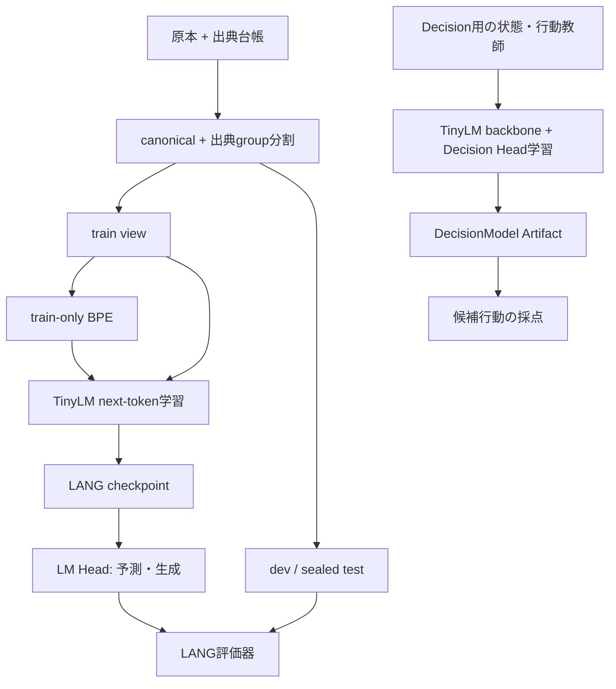
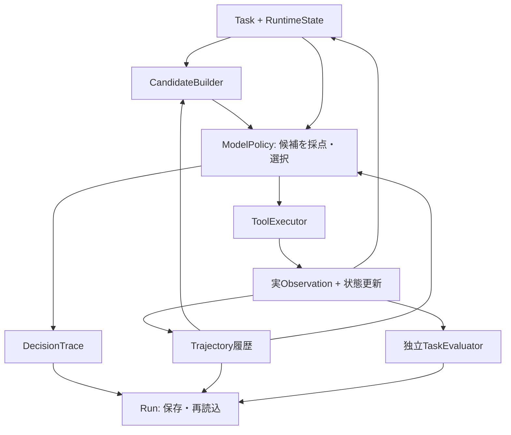
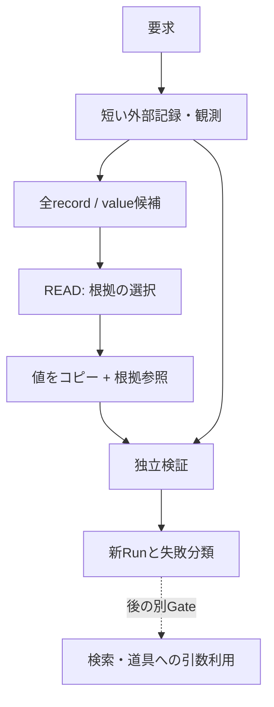

# Aster システム図と現在地

2026-10-14 JST。確認元: main `ffeda9ddb33a963fd9a6116259d6ca9713f9bb59`。
図の実線は実装済みの接続を示す。能力が実証されたことは意味しない。将来の接続は別図に置く。

## 学習と推論

LANGとDecisionはTinyLMという実装を共有するが、同じ学習済み重み・Tokenizer・context長を使用しているとは限らない。
LANG v0 pilotは約174,080 parameters / vocab514 / context128。
OBSで固定されたDecisionModelのcontextはユーザー報告では2048であり、LANGの128をAgentへ流用しない。
重み移植や共通artifact化は未実装の研究案。sealed test本文は現在のTrialでは読まない。

## 実装済みのAgent経路

候補器が引数を準備する部分、モデルが候補を選ぶ部分、道具が実行する部分を区別する。
現行calculate-and-store候補器は成功calculator観測からputの値をコピーする。モデルが値を自力生成した証拠ではない。
Evaluatorは採点側であり、正解ラベルをModelPolicyへ戻す経路ではない。
Service/WebはJob・Run・Artifact・研究結果を操作・表示する入口。配線とモデル能力を分けて表示する。

## 現在の証拠

| 系列 | 実装 / 報告された観測 | まだ示していないこと |
| --- | --- | --- |
| LANG v0.3 #110 | 1dev文書でbigram NLL4.75475、TinyLM4.74216; 6箇所のprefix変更へ反応 | 元文脈の利益、独立文書での再現、意味理解 |
| LANG生成 #99 | UTF-8制約で技術的破損を改善; trained6/6で反復、0/6一貫したprose | 実用的日本語生成 |
| OBS v0c #106 | missing-key後calculatorを選んだが、その次にstop; task失敗 | 観測値を保存・取得確認して完了する能力 |
| READ v0 #115 | 設計案だけ | コード・学習・能力測定すべて未実施 |

私的モデル/原本は本環境で取得していない。上の数値は公開reportまたはユーザー報告をGitHubへ記録したもの。
実装文書の古いPENDING表記より、新しいIssueコメント/結果reportを優先し、元の結果を修正しない。

## 次の研究と将来案

当面の実験Gateは #113「元の文脈が予測に役立つか」。後続の機能候補は #115「観測から必要な値を根拠付きで選ぶ」。
詳細は [EvidenceUse-v0-plan](EvidenceUse-v0-plan.md)。

この図は未実装。検索、計画、一般日本語QA、棄権学習、Generator/Solver/Curriculumはそれぞれ後の別Gate。
自動的な `Run -> training data -> model v+1` は現行の既定ループではない。採用判断・分割・凍結した別実験が必要。
