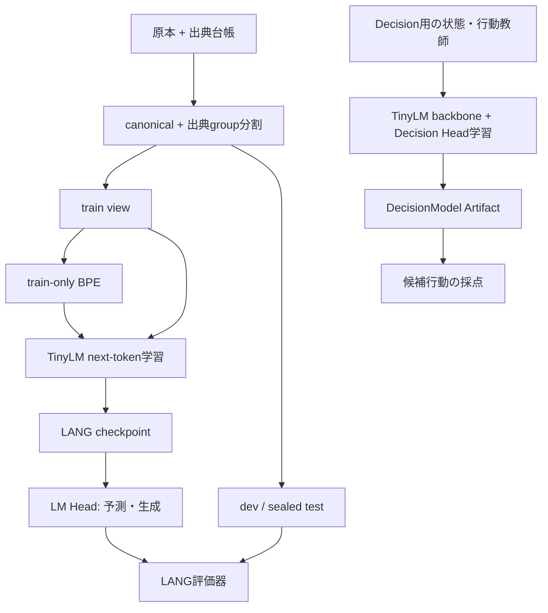
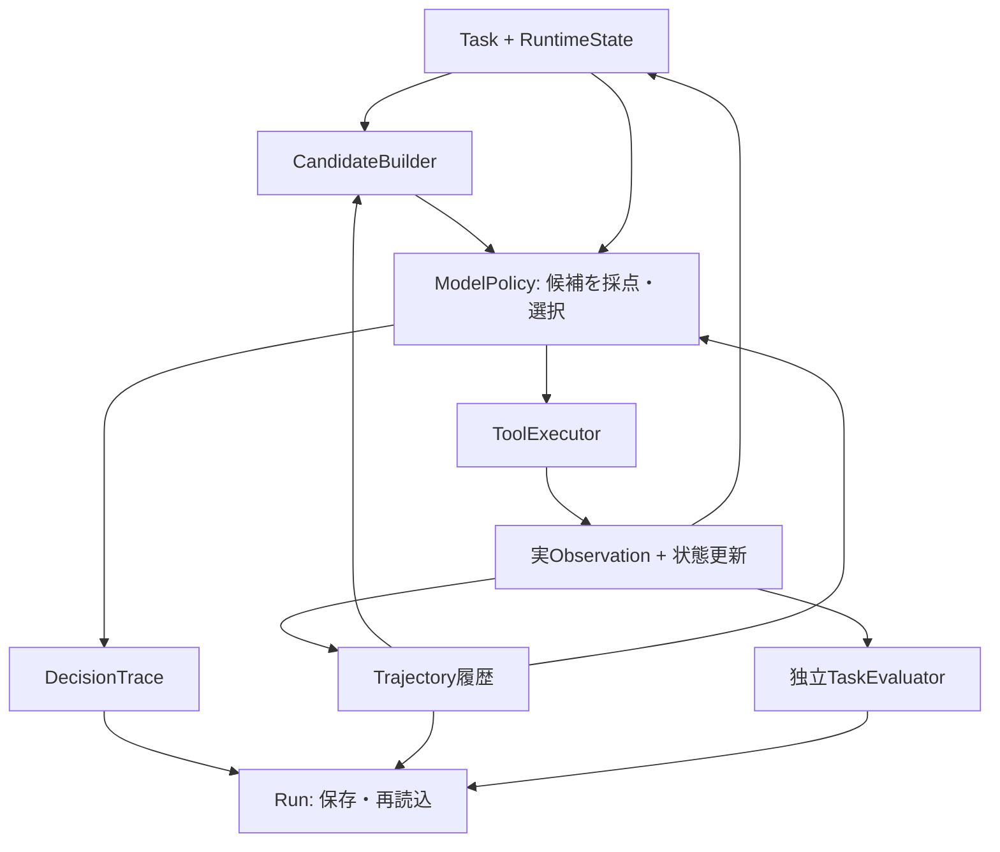
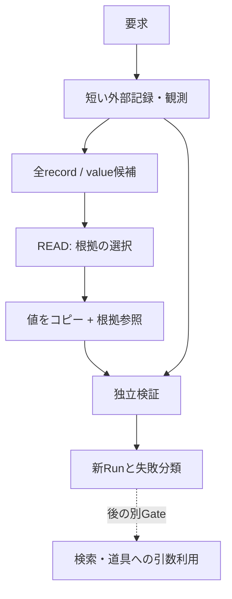
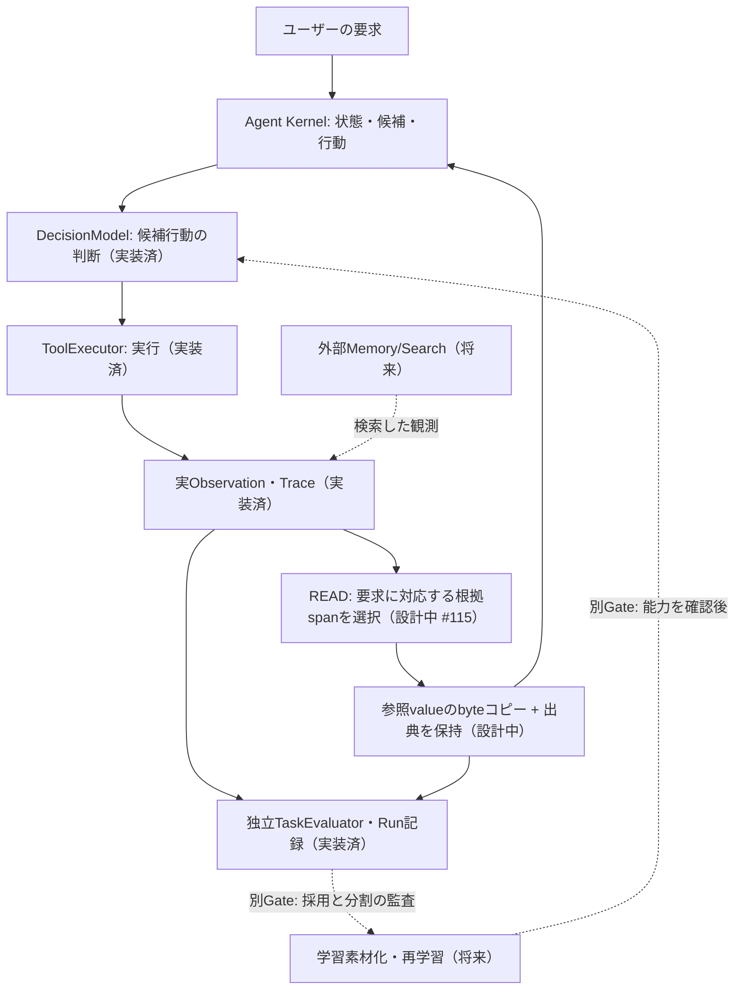
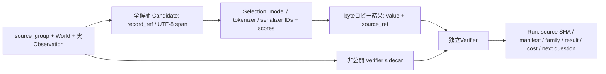

# Aster システム図と現在地

2026-10-14 JST。確認元: main `ffeda9ddb33a963fd9a6116259d6ca9713f9bb59`。
図の実線は実装済みの接続を示す。能力が実証されたことは意味しない。将来の接続は別図に置く。

## 学習と推論

LANGとDecisionはTinyLMという実装を共有するが、同じ学習済み重み・Tokenizer・context長を使用しているとは限らない。
LANG v0 pilotは約174,080 parameters / vocab514 / context128。
OBSで固定されたDecisionModelのcontextはユーザー報告では2048であり、LANGの128をAgentへ流用しない。
重み移植や共通artifact化は未実装の研究案。sealed test本文は現在のTrialでは読まない。

## 実装済みのAgent経路

候補器が引数を準備する部分、モデルが候補を選ぶ部分、道具が実行する部分を区別する。
現行calculate-and-store候補器は成功calculator観測からputの値をコピーする。モデルが値を自力生成した証拠ではない。
Evaluatorは採点側であり、正解ラベルをModelPolicyへ戻す経路ではない。
Service/WebはJob・Run・Artifact・研究結果を操作・表示する入口。配線とモデル能力を分けて表示する。

## 現在の証拠

| 系列 | 実装 / 報告された観測 | まだ示していないこと |
| --- | --- | --- |
| LANG v0.3 #110 | 1dev文書でbigram NLL4.75475、TinyLM4.74216; 6箇所のprefix変更へ反応 | 元文脈の利益、独立文書での再現、意味理解 |
| LANG生成 #99 | UTF-8制約で技術的破損を改善; trained6/6で反復、0/6一貫したprose | 実用的日本語生成 |
| OBS v0c #106 | missing-key後calculatorを選んだが、その次にstop; task失敗 | 観測値を保存・取得確認して完了する能力 |
| READ v0 #115 | 設計案だけ | コード・学習・能力測定すべて未実施 |

私的モデル/原本は本環境で取得していない。上の数値は公開reportまたはユーザー報告をGitHubへ記録したもの。
実装文書の古いPENDING表記より、新しいIssueコメント/結果reportを優先し、元の結果を修正しない。

## 次の研究と将来案

当面の実験Gateは #113「元の文脈が予測に役立つか」。後続の機能候補は #115「観測から必要な値を根拠付きで選ぶ」。
詳細は [EvidenceUse-v0-plan](EvidenceUse-v0-plan.md)。

この図は未実装。検索、計画、一般日本語QA、棄権学習、Generator/Solver/Curriculumはそれぞれ後の別Gate。
自動的な `Run -> training data -> model v+1` は現行の既定ループではない。採用判断・分割・凍結した別実験が必要。

## Aster全体の能力地図（2026-10-15：企画整理 / 未実装を含む）

**開発目的**: 小さいモデルと偏りの残るCorpusを前提に、モデルが学ぶべき「関係選択・判断」と、外部へ委ねられる「事実保存・計算・検証」を分離する。これは能力保証ではなく、検証順の設計。

矢印は**データの流れまたは将来検証する接続**。実装済み要素が同じRunで全て統合・成功したという意味ではない。
READは検索や生成を初版に混ぜず、まず「既に得た短い観測から正しい根拠を選択できるか」に限定する。正解sidecarをモデルへ渡さない。固定の入力形式は**実験足場**であり、形式の異なる未知文章へ汎化した証拠にはならない。

### 段階ごとの能力と証拠境界

| 順 | 能力 / 機能 | 状態 | 次に確かめること | 正本 |
| --- | --- | --- | --- | --- |
| 0 | Tokenizer / TinyLM / Agent配線 | 実装済み、能力は限定的 | 既存checkpointと評価器を固定 | [README](../README.md) |
| 1 | CONTEXT: 以前の文章が有益か | 診断中 | 保存済み6 caseの符号付き利益、その後の出典group設計 | [#113](https://github.com/ryonakayama234/Aster/issues/113) |
| 2 | READ: 要求と観測を照合し根拠を選ぶ | 設計のみ / NOT_RUN | paired worldで根拠+値の両方を正しく選択できるか | [#115](https://github.com/ryonakayama234/Aster/issues/115) / [提案記録](experiments/read-evidence-selection-v0.json) |
| 3 | SEARCH: 必要な短い証拠を取得 | 将来 | 検索結果が欠落・矛盾した際の振る舞い | [EvidenceUse計画](EvidenceUse-v0-plan.md) |
| 4 | VERIFY / MEMORY: 出典と有効期間を扱う | 将来 | 新旧・矛盾・欠落・再利用の区別 | [EvidenceUse計画](EvidenceUse-v0-plan.md) |
| 5 | Agent再試行、Generator/Solver/Evaluator/Curriculum | 将来 | 未知状態への転移、学習効果、既存能力保持 | [Experiment Cycle](ExperimentCycle-v0.md) |

### 機能別のデータ契約と実験記録

**漏洩防止**: Worldの正解、split、gold spanはモデル不可視。候補器は要求keyで正解を絞り込まない。Task family由来の変形やseedを独立例数へ水増ししない。RAWデータやprivate checkpointはGitに格納しない。

**初期構造に頼りすぎないための段階設計**: まず要求keyと値の対応という最小の関係に限定し、位置交換・値交換・未知値・別template groupを対照にする。固定形式で成功しても、日本語自由文は未証明。失敗した場合は候補欠落、token上限、ラベル漏洩、学習不足を分け、同じTask/Tokenizer/head/更新予算でscratchと事前学習初期化を比較する*別Gate*を検討する。ルール対照の成功をAsterのモデル能力として数えない。

**毎機能PRの最低構成**: (a) この全体図または機能図、(b) 入力・出力・可視性・source/artifact lineage、(c) `docs/experiments/` のNOT_RUNを含む実験記録または `reports/` の実測結果、(d) 比較条件・失敗分類・停止条件・次の一問。実験のTrialとBatchは[ExperimentCycle-v0](ExperimentCycle-v0.md)に従う。

**この追記の証拠範囲**: ドキュメント整理のみ。学習0、モデル評価0、sealed test開封0。追加した図の将来経路に実行実績はない。既存 #113 / #115 / Draft PR #116 を正本とし、重複Issueを作らない。

## 実行タスクと達成目標（2026-10-15 / NOT_RUN）

実装・研究を混同しない作業順は [READ 実行TODO](TODO/ReadEvidence-v0.md)、進捗と未計測状態は [READ Progress](Progress/ReadEvidence-v0.md) を正本とする。提案数字は6 task-family×8 pair=48 pair、96 worlds、192 candidate exposures。reference 48/48、固定位置対照24/48、次の独立検証を設計するための暫定判断目安は36/48（75%）+複数family。**protocol未凍結・READ実装/実測なし**。なお#113-Aの私的Run集計を先に行い、結果不明なら推測して次GateをPASSにしない。
